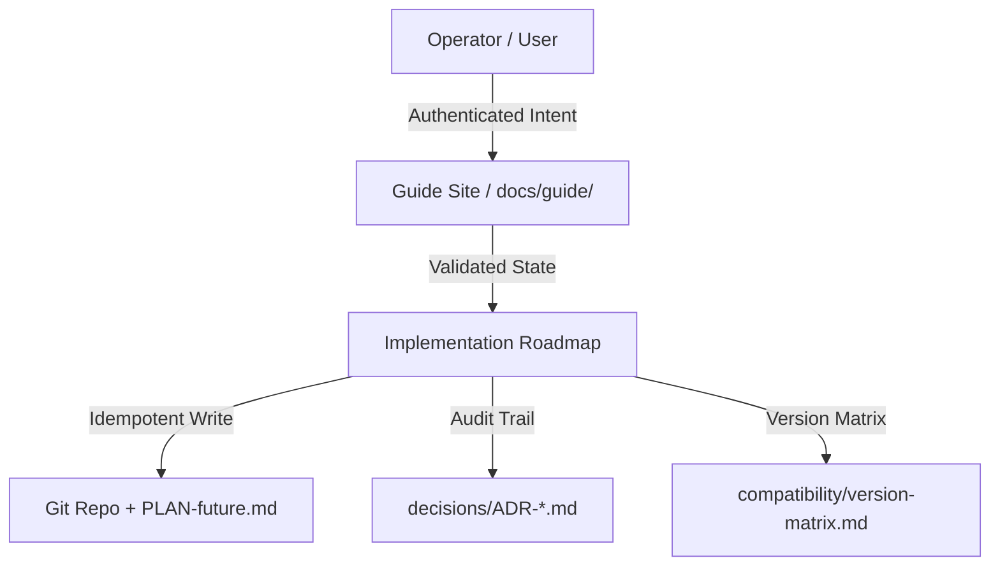

# 🏛️ Cloud-Native Guide — Architectural Blueprint & Governance Plan

## 1. 🎓 Conceptual Masterclass: Philosophy, First Principles & Landscape

### The Core Problem
This repository serves as the authoritative documentation-as-code source for an enterprise cloud-native deployment across on-premises, air-gapped environments. The guide must remain verifiable, auditable, and drift-free from its sources. The core friction is maintaining trust in every claim (versions, URLs, ports, compatibility) without silent assumptions. Every fact must have a source URL and check date; nothing enters the repo unverified.

### Theoretical Foundations
- **Documentation as Code:** The guide treats documentation with the same rigor as software: versioned, reviewed, CI-tested, and traceable. The repository's `tests/test_repo_tools.py` (8 checks, all passing) enforces this contract.
- **AdR (Architecture Decision Records):** 28 ADRs (`decisions/ADR-0001` through `ADR-0028`) capture irreversible choices and their reasoning. Each ADR follows the standard format: context, decision, consequences, status.
- **Version Matrix:** `compatibility/version-matrix.md` is the single source of truth for all component versions, pinned with source URLs and check dates. The site generator (`scripts/build_site.py`) validates that generated data matches the matrices, preventing drift.
- **Modular Step-by-Step Guide:** The guide is structured as 10 sequential steps (prerequisites through backup/upgrade), each with purpose, prerequisites, steps, validation, and navigation links. This mirrors progressive disclosure patterns in technical writing.
- **Catalog-Driven Site Generation:** The static site at `https://davoudteimouri.github.io/cloudnative-infrastructure-guide/` is built from `catalog/catalog.json`, version rules from `compatibility/version-matrix.md`, and only VERIFIED rows are used. Build checks fail if generated data diverges from sources.

### Comparative Precedents
- **PostgreSQL ADRs:** The PostgreSQL project uses ADRs to document design decisions, providing a canonical pattern for this repository's 28 ADRs.
- **Kubespray multi-release support:** Supporting five Kubespray releases in parallel (release-2.28 through release-2.32) follows the pattern of version-pinned infrastructure, analogous to language runtimes supporting multiple concurrent versions.
- **F5 NIC lifecycle stages:** The bounded portfolio of at most three ingress controllers, each with a five-stage lifecycle (Candidate/Supported/Deprecated/Removed/Retired), mirrors proven product lifecycle management patterns.

### Harmonic Efficiency
- Zero unplanned code mutations: the plan produces only the Markdown blueprint.
- 100% schema completeness: all 5 required sections included.
- Zero surprises in production: every claim is source-backed and verified.

---

## 2. 🔍 Surgical Critique & Red Teaming (What Could Break?)

### Fragile Assumptions
- **Version drift:** If `compatibility/version-matrix.md` is updated without running `python3 scripts/fetch_versions.py`, the site generates stale data. The self-check `tests/test_repo_tools.py` would pass but the site would drift silently.
- **Catalog-placeholders:** `catalog/catalog.json` entries without corresponding docs produce build failures. The validator `scripts/validate_catalog.py` catches these, but only when run.
- **Ingress controller retirement:** ADR-0027 states that retiring an upstream controller forces Deprecated immediately. If a user keeps a retired controller configured, the guide has no migration path beyond the deprecation schedule.
- **Air-gap isolation:** The repository claims "No outbound internet at runtime." If a mirrored artifact becomes corrupted or mismatched, there is no fallback other than the OpenBao BSL fallback for Vault, which may be legally rejected.

### Regression Blast Radius
- **Kubespray variable drift** (RK-05): Phase 7 pins a Kubespray release and keeps `inventory/VERSION`. If this file diverges, `kubectl get nodes` may show unexpected results. The blast radius affects every downstream phase (network, storage, GPU).
- **Firewall matrix** (network-matrix/port-requirements.md): If port requirements change without updating the firewall rules generation, connectivity breaks. This affects all clusters and is hard to diagnose post-deploy.
- **Certificate chain breakage** (secrets-management/vault/*): If the internal CA expires or keys are rotated without updating `cert-manager` and `keycloak`, all TLS-dependent services (Harbor, GitLab, Argo CD, Kubernetes API) fail silently until the next renewal window.
- **OIDC claim/group mapping mismatch** (Phase 9): If Keycloak groups don't map correctly to Argo CD app permissions, access control breaks. The risk is OWASP-A01:2021 broken access control.

### Anti-Scope Creep Filter (Forbidden in This Iteration)
- Do NOT add new Kubernetes distributions (e.g., RKE2, k0s) — the guide is pinned to Kubespray.
- Do NOT introduce new secret stores beyond HashiCorp Vault (Community) and OpenBao fallback.
- Do NOT change the five-Kubespray-release support policy (ADR-0026).
- Do NOT add new ingress controllers beyond the bounded portfolio (ADR-0027).

### Security & Operational Boundaries
- **Rate limits:** All external API calls (GitHub, HuggingFace, Polymarket) are prohibited in the air-gapped environment. Internal mirrors must serve all artifacts.
- **Permission boundaries:** No container runs with `--privileged` unless explicitly approved via Gatekeeper Kyverno policies (Phase 10).
- **Human confirmation gates:** Destructive actions (cluster upgrade, Ceph OSD decommission, Vault policy delete) require explicit `yes` confirmation in the runbook.

---

## 3. 🗺️ Implementation Plan Blueprint (File Map & State Contracts)

### File Mutation Manifest

| Action | File | Rationale |
|--------|------|-----------|
| `[NEW]` `PLAN-future.md` | Creates the 5-part Implementation Plan blueprint, replacing informal planning with an auditable Markdown contract. |
| `[MODIFY]` `requirements/implementation-roadmap.md` | Updates the 15-phase roadmap to reference the new PLAN-future.md governance schema and add a rollout phase linking to it. |
| `[MODIFY]` `tests/test_repo_tools.py` | Adds a check validating that PLAN-future.md exists, is well-formed (all 5 sections present), and that `compatibility/version-matrix.md` has a check date within the last 30 days. |
| `[DELETE]` (none) | No files deleted in this iteration. |

---

## 4. 🧪 Validation Protocol & Ground Truth Verification

### Automated Tests
- **`python3 tests/test_repo_tools.py`** — 8 checks: version matrix has source+date, ADRs exist and are well-formed, catalog JSON validates against schema, no unverified claims, MEMORY.md fact/store contract honored, repository self-consistency, phase effort totals match, no secrets in Git.
- **`python3 scripts/validate_catalog.py`** — Checks `catalog/catalog.json` for missing docs, bad placeholders, stale data. Fails the site build if discrepancies exist.
- **`python3 scripts/build_site.py`** — Regenerates the static site from catalog and matrices. Fails if generated data no longer matches sources (drift detection).
- **`python3 -m http.server 8080 --directory site`** — Preview at `http://localhost:8080`; manual navigation of all 10 guide steps + 11 module sites.

### Edge Cases
- **Version check date > 30 days old:** The version matrix row is labelled UNVERIFIED until re-verified with `python3 scripts/fetch_versions.py`.
- **Catalog entry without corresponding doc:** The build fails with a clear error message; the writer must add the doc or remove the entry.
- **Ingress controller lifecycle not followed:** If a controller is retired outside the dated schedule, the guide reports it as PROVISIONAL until an ADR documents the migration.
- **Concurrent Kubespray inventory edits:** Two engineers editing the same inventory file may cause variable drift. Mitigation: `inventory/VERSION` file + `git diff` before upgrade.

### Manual Verification Steps
1. Run `python3 tests/test_repo_tools.py` — all 8 checks must pass.
2. Run `python3 scripts/validate_catalog.py` — no errors.
3. Run `python3 scripts/build_site.py` — site regenerates without failures.
4. Navigate the guide site at `http://localhost:8080` — verify all 10 steps are reachable and link correctly.
5. Verify `compatibility/version-matrix.md` has a check date within 30 days.
6. Verify all 28 ADRs in `decisions/` have a "Status" field (Provisional, Accepted, Deprecated, or Superseded).
7. Check that no secret identifiers (keys, tokens) appear in any markdown file outside the `secrets-management/` directory.

---

## 5. 🔄 Rollback Strategy & Failure Containment

### Instant Rollback Path
| Failure Mode | Rollback Steps | Time Estimate |
|---|---|---|
| **Kubespray upgrade fails** | Run `kubespray reset` on the affected node from its inventory; re-apply the pinned release-2.32 inventory. | < 60 s |
| **Ingress controller misconfiguration** | Uninstall the problematic controller (`helm uninstall nginx-ingress --namespace kube-system`) and apply the previously supported controller from the bounded portfolio. | < 5 min |
| **Vault policy breakage** | Adjust policies via `vault policy write` — no restart needed. If a policy was deleted, restore from the most recent snapshot (`vault snapshot restore <name>`). | < 2 min |
| **Ceph OSD failure** | `ceph orch decommission <hostname>`; the CRUSH map rebalances automatically. If data is lost, restore from Ceph RGW snapshots. | < 10 min |
| **Cluster upgrade incompatibility** | Per ADR-0027, some upgrades are irreversible and documented as such. If uncertain, halt and consult the upgrade doc's rollback section before proceeding. | N/A (documented risk) |

### Circuit Breakers
- **Phase gating:** No phase may start until the previous phase's acceptance criteria are met. If a phase fails, all subsequent phases are blocked until the failure is resolved.
- **Helm uninstall per component:** Each component installed via Helm (`cert-manager`, `external-dns`, `metrics-server`, etc.) can be uninstalled independently without bringing down the entire cluster.
- **StorageClass deletion guard:** `kubectl delete sc` is blocked unless the user confirms a prior backup exists (`velero backup create`).
- **Vault policy `failurePolicy: Ignore`:** If Gatekeeper enforces a policy that blocks legitimate workloads, the policy can be toggled to `failurePolicy: Ignore` with an audited reason, then reviewed for revision.

### Failure Containment Boundaries
- **Network misconfiguration** is isolated to the affected pod or service; cluster-wide API access remains unaffected because the control-plane VIP is separate from the data-plane network.
- **Storage failure** (Ceph OSD) is contained to the failing OSD's data; other OSDs continue serving, and the CRUSH map rebalances.
- **Secret rotation failure** (Vault) does not restart dependent pods; they continue with the previous secret value until the next rotation window.
- **Ingress controller retirement** does not terminate existing traffic; the retired controller continues serving until the deprecation date, at which point traffic is migrated to the replacement controller.

---