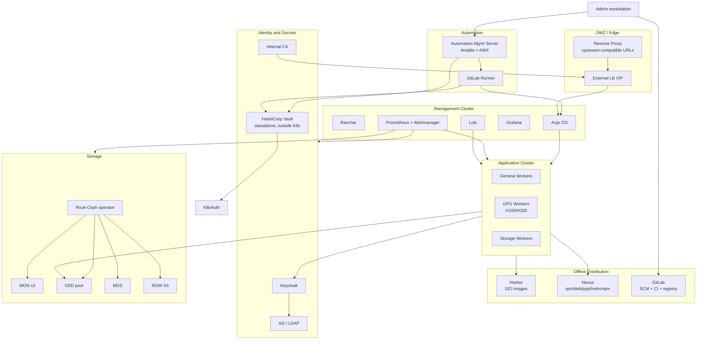

# Logical Architecture (Mermaid)

## Critical path

Offline artifact distribution -> OS provisioning -> K8s control plane -> Ceph -> CSI -> Argo CD -> workload.
Secrets and identity sit on the side; they must not gate the restore path (ADR-0025).
